# Chromium PS5

Debian's x86-64 Linux Chromium running inside a native PS5 homebrew app (title
**CHRM00000**): Linux as a library (LKL) underneath, and **gx**, a guest executor that loads
Linux programs and turns their system calls into calls to the console. gx is derived from
[chromium-nx](https://github.com/shodowlo/chromium-nx) by shodowlo and ported to x86-64.

Version **0.9.3 build 41**, for PS5 firmware 4.00 with kstuff and ShadowMount.

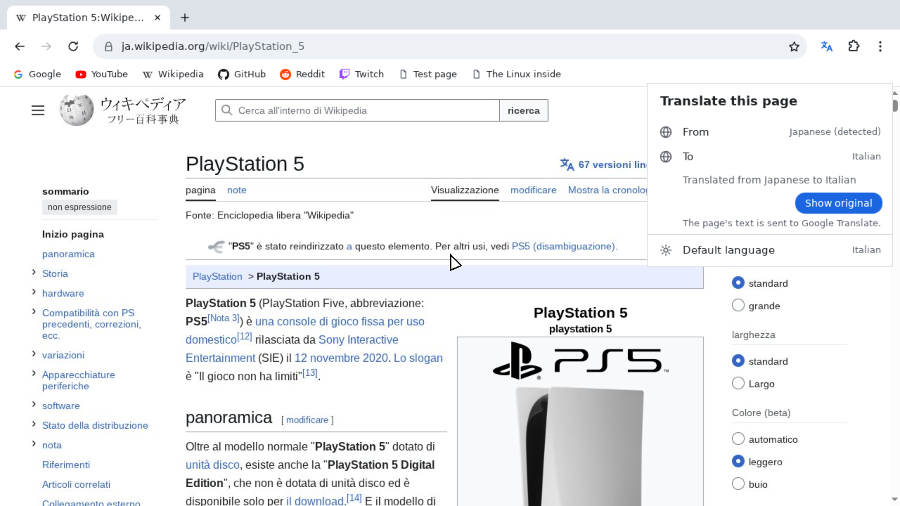

| | |
|---|---|
| 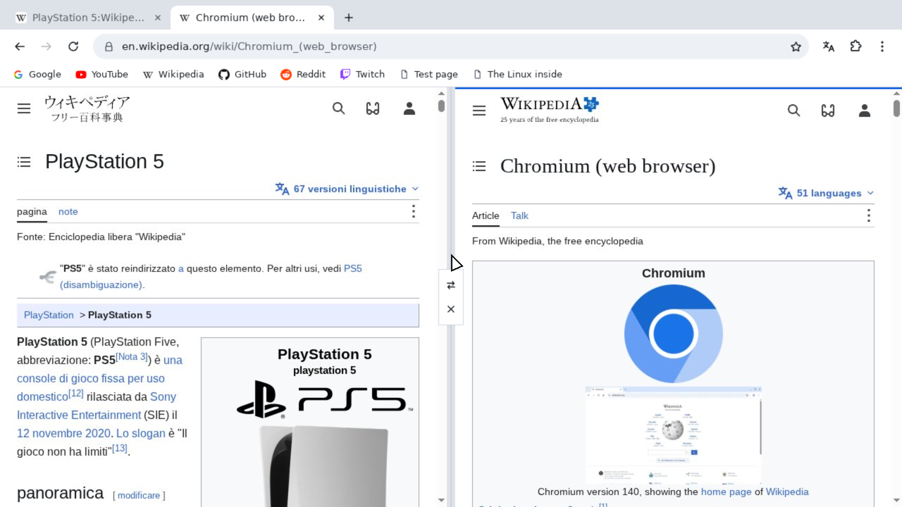 | 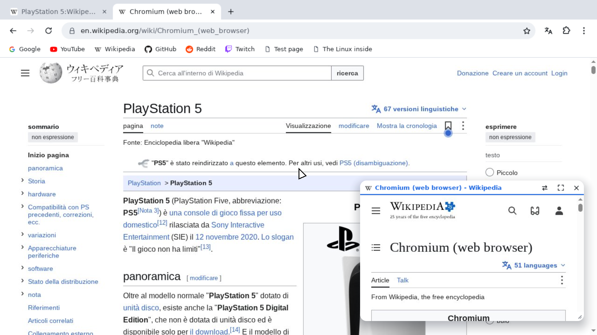 |
| Two tabs side by side | A tab as a floating window |
| 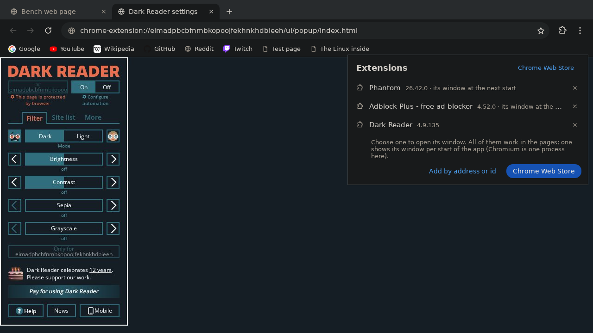 | 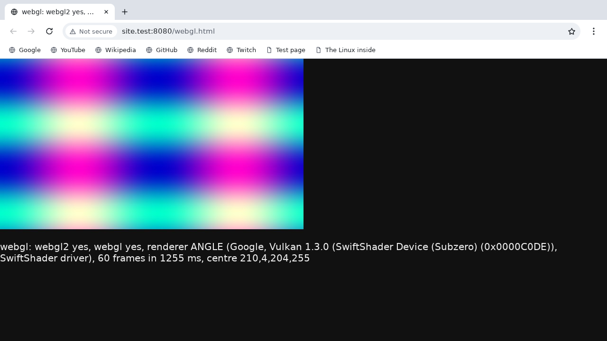 |
| Extensions from the Chrome Web Store (picture from 0.8.0) | WebGL 2 through SwiftShader |

These pictures come from the project's PC test bench, which runs the same code as the
console.

## What it does

- **A real browser engine.** Every page is drawn by Chromium 156 (Blink and V8); the app
  shows it at up to 60 pictures a second. JavaScript is compiled (V8's JIT) and WebAssembly
  runs. Settings → JavaScript has Fast and Safe, and the app goes to Safe by itself when two
  starts in a row end early.
- **Tabs**, up to 12, with a tab strip, back, forward, reload, an address bar that searches
  (Google, DuckDuckGo, Bing or Brave), bookmarks, history and a new tab page. The open tabs
  come back at the next start; "Reopen closed tab" and "Close tabs to the right" are in the
  menus.
- **Two tabs on the screen**: split screen, with a bar in the middle that drags, or one tab
  as a floating window that moves and changes size. Hold a tab and drag it down onto the
  page (left or right splits, the middle makes it float), or use the menu.
- **Translate**, the button after the address bar: the page is translated where it is, from
  any language (found by itself, or chosen) to any of 133. What the page adds later is
  translated too, and so are the next pages of the same site; "Show original" brings the
  page back. The language to translate to is the console's until another one is chosen, in
  the panel or in Settings → Languages. The page's text is sent to Google Translate.
- **Extensions and themes from the Chrome Web Store**: "Add to Chrome" on the store's page
  installs them, and so does "Add by address or id" in the extensions panel. A theme colours
  the app's interface.
- **Sound**, for videos and pages ("Turn the sound off" is in the menu's More tools).
- **Cookies, logins and extensions are kept** between starts, on a data disk the app makes
  at its first start (`/data/chromium-ps5/browser.img`).
- **The system keyboard** for the address bar and for every box in a page.
- **The controller's touchpad as a mouse**: slide to move, tap to click, two fingers to
  scroll, two-finger tap for the menu of what is under the cursor, press and slide to drag.
- **Real full screen** for videos (YouTube included), covering the tab strip too.
- **Downloads**, written straight to the console's disk as they arrive, so a file does not
  have to fit in memory: to `/data/download` (the folder Torrent & DL uses too) or
  `/data/homebrew`. An app image (`.ffpkg`) always asks where it goes. "Save page as PDF"
  writes to the same folder.
- **Incognito**: nothing is added to the history, and cookies and site data are forgotten
  when you leave it.
- **Ad block** (Settings → Privacy): advertisers and trackers are not contacted, and YouTube
  plays without its ads.
- **WebGL 1 and 2**, drawn in software by SwiftShader (no GPU of the console's is used yet);
  3D games draw at half resolution by default for more frames (Settings).
- **Fonts** with the measures of Arial, Times New Roman and Courier New (Liberation), colour
  emoji, Chinese, Japanese, Korean, Thai, the languages of India, Arabic, Hebrew and more.
- **Screenshots** from the menu, saved in `/data/chromium-ps5/screenshots`.
- Find in page, zoom, light and dark themes (the dark one is passed on to the sites), site
  information, "Not secure" for plain http, "View page source", cookies and cached pages
  cleared from Settings → Privacy, and a menu on the other button (open link in new tab,
  copy, search for the selection, translate, video in full screen).
- A complete log: on screen (hold Options), live over the network (`nc <ps5-ip> 9031`) and
  in `/data/chromium-ps5/logs/`, with crash reports.

The last build run on a PS5 is 0.9.2 build 40. The Translate button is new in 0.9.3 and has
been tested on the PC test bench so far; the sound has not been confirmed on a console yet.

### On a PS5

| | |
|---|---|
|  | 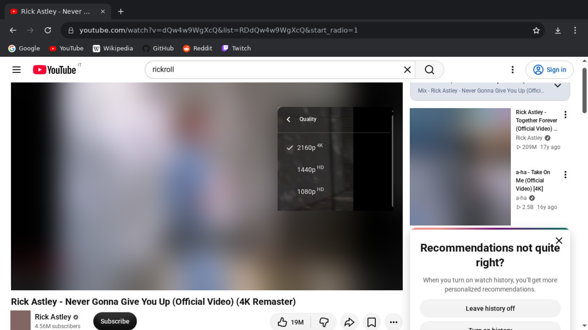 |
| The new tab page | YouTube with its 2160p player (the video's picture is hidden here) |
| 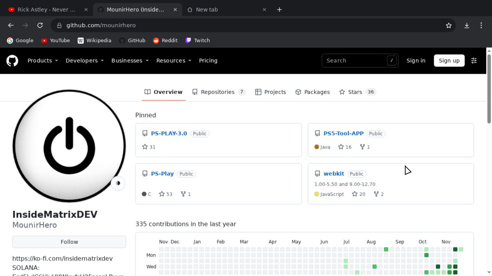 | 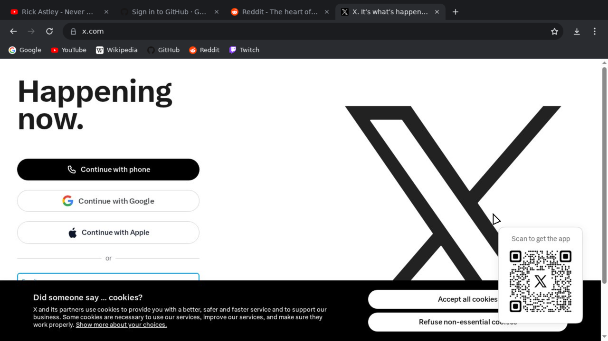 |
| GitHub | Several tabs |

Screenshots taken on a PS5 with the menu's "Take a screenshot", with version 0.7: the tool
bar has gained the Translate and extensions buttons since.

### More pictures

| | |
|---|---|
| 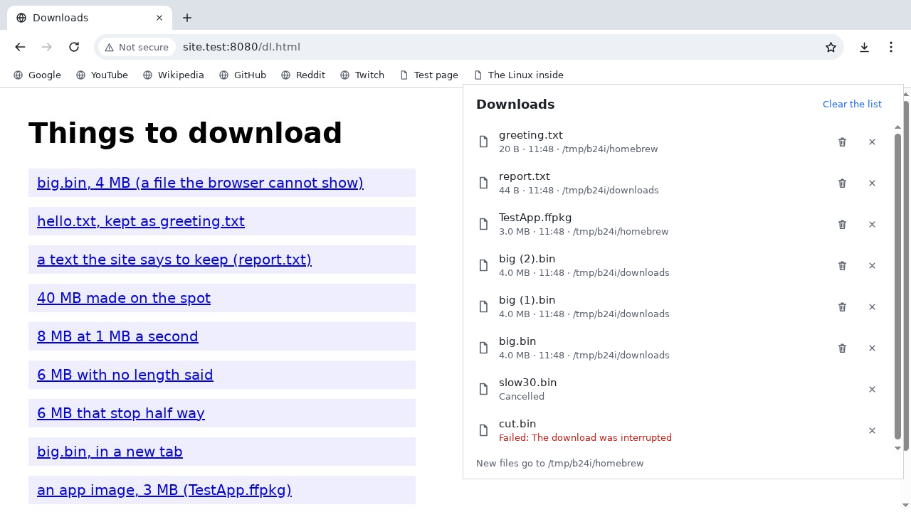 | 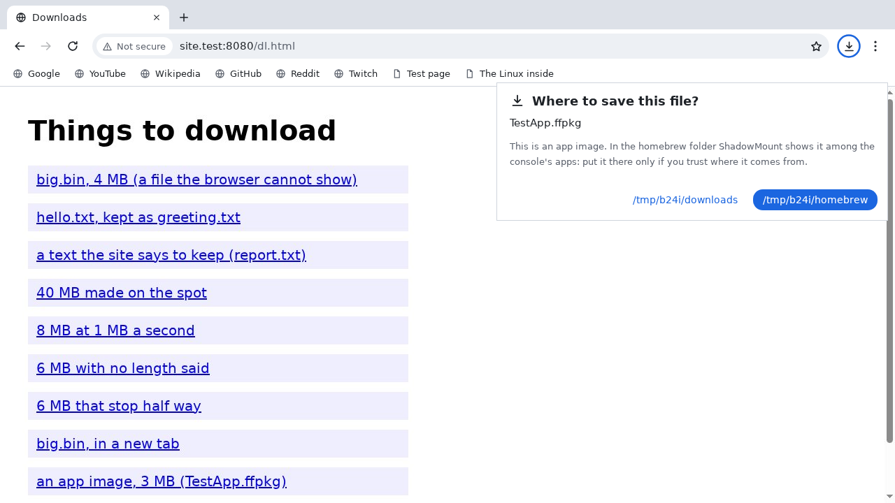 |
| Downloads: progress, speed, time left, both folders | An app image asks where to go |
| 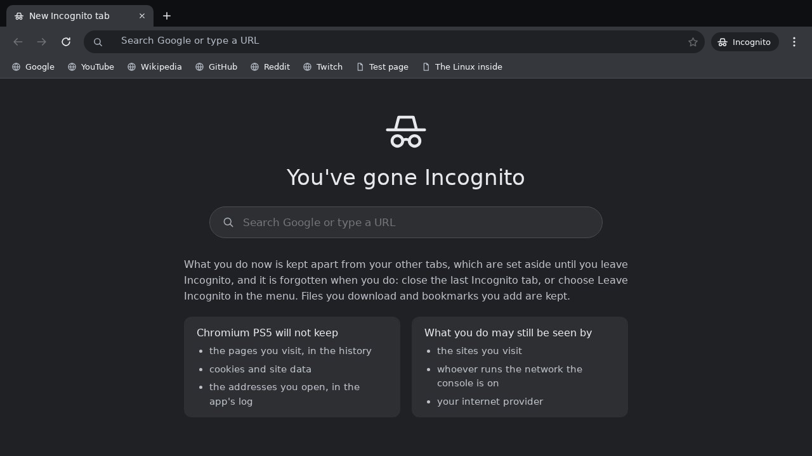 | 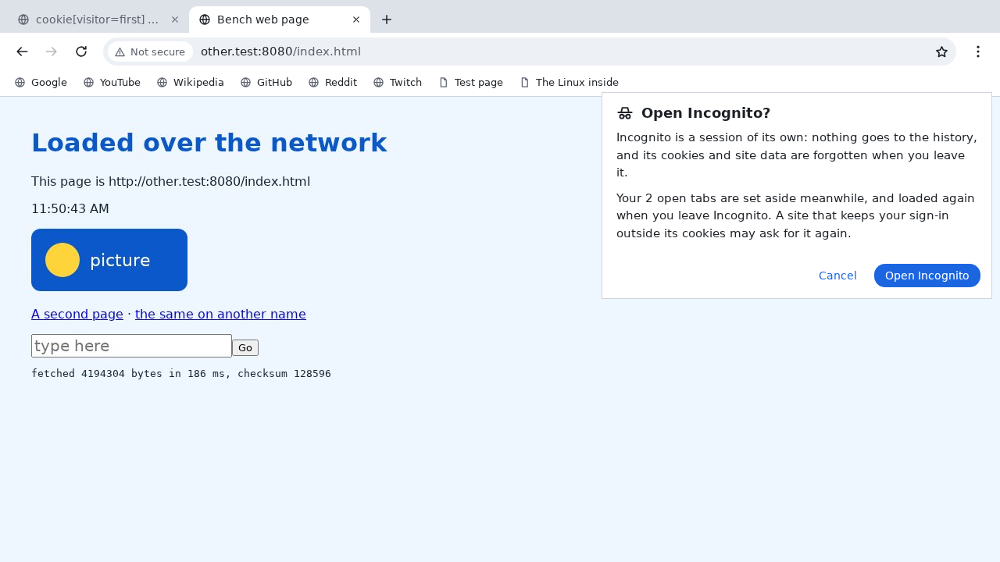 |
| Incognito | What Incognito does with the open tabs |
|  | 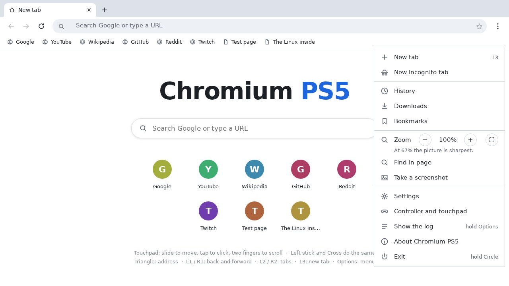 |
| The menu of a link | The new tab page |

From the PC test bench, with version 0.7.

## Install

1. Download `CHRM00000.ffpkg` from the Releases, copy it to `/data/homebrew/` and mount it
   with ShadowMount (or copy the `CHRM00000` folder from the release zip to
   `/data/homebrew/`).
2. Open Chromium PS5. Hold Circle for two seconds to close it.

That one file carries everything, the Linux system included. Coming from 0.8.6 or older:
`/data/chromium-ps5/rootfs.img` is not read any more and can be deleted; `browser.img`,
`profile`, `logs` and `screenshots` in the same folder are in use.

## Controller

| | |
|---|---|
| Touchpad, one finger | Slide to move, tap to click, two taps to select a word |
| Touchpad, two fingers | Slide to scroll, tap for the menu |
| Touchpad pressed | Click and drag (with two fingers: the menu) |
| Left stick / Cross | Cursor / click (hold to drag; on a text box the keyboard opens) |
| Right stick | Scroll |
| D-pad | Arrow keys |
| R2 | Enter |
| Square | Type an address or a search |
| Triangle | Reload |
| Circle | Back, close a panel, leave full screen (held two seconds: close the app) |
| L1 / R1 | Previous / next tab |
| L3 / R3 | Show the cursor / zoom |
| Options | Menu (held: the log) |

## Not there yet

- **The console's GPU.** Pages and WebGL are drawn in software.
- **More than one process.** Chromium runs here as one process, so Incognito is a mode and
  not a window beside the ordinary tabs, and one extension shows its own window per start of
  the app (all of them work in the pages).
- **Chrome's own interface.** This one is the app's own page with the same layout, drawn by
  Chromium itself.
- **Translate** leaves alone what is inside frames, and does not turn the page around for
  languages written from right to left.
- **The system clipboard**: copy and paste stay inside the browser.

## About the files here

The `CHRM00000` folder is the app without two files: `rootfs.img`, the Linux system the app
starts (200 MB, more than GitHub takes in one file), and `sce_module/libc.prx`, which is
Sony's. Both are inside the release files, so install from a Release.

Chromium is Debian's package. One fix is applied to its program when the image is made:
three calls, seven bytes each, are taken out so that saving a PDF does not close the browser
when everything runs in one process.

Licenses: GPL-2.0 (gx, LKL), GPL-3.0-or-later (app shell, ps5-opengl). Not affiliated with
Google or Sony.
