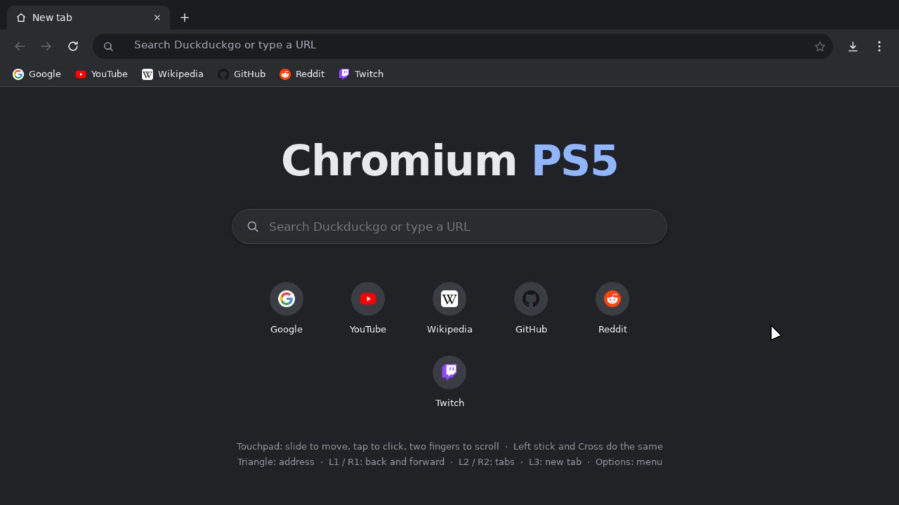
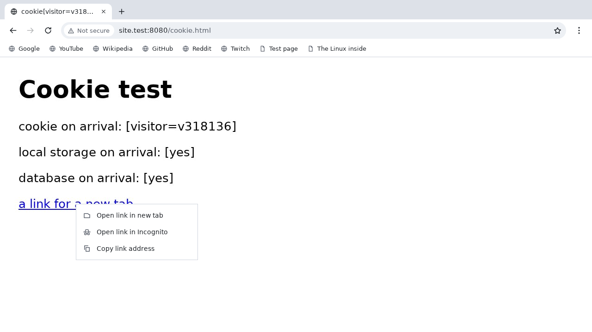

# Chromium PS5

Debian's x86-64 Linux Chromium, unmodified, running inside a native PS5 homebrew app
(title **CHRM00000**): Linux as a library (LKL) underneath, and **gx**, a guest executor
that loads Linux programs and turns their system calls into calls to the console. gx is
derived from [chromium-nx](https://github.com/shodowlo/chromium-nx) by shodowlo and ported
to x86-64.

Version **0.7.2 build 26**, for PS5 firmware 4.00 with kstuff and ShadowMount.

| | |
|---|---|
|  |  |
| YouTube with its 2160p player (the video's picture is hidden here) | Several tabs |
|  |  |
| GitHub | WebGL 2 through SwiftShader |

These four are screenshots taken on a PS5 with the menu's "Take a screenshot".

## What it does

- **A real browser engine.** Every page is drawn by Chromium 156 (Blink and V8); the app
  shows it at up to 60 pictures a second.
- **Tabs**, up to 12, with a tab strip, back, forward, reload, an address bar that searches
  (Google, DuckDuckGo, Bing or Brave), bookmarks, history and a new tab page.
- **The system keyboard** for the address bar and for every box in a page.
- **The controller's touchpad as a mouse**: slide to move, tap to click, two fingers to
  scroll, two-finger tap for the menu of what is under the cursor, press and slide to drag.
- **Real full screen** for videos (YouTube included), covering the tab strip too.
- **Downloads**, written straight to the console's disk as they arrive, so a file does not
  have to fit in memory: to `/data/download` (the folder Torrent & DL uses too) or
  `/data/homebrew`. An app image (`.ffpkg`) always asks where it goes.
- **Incognito**: nothing is added to the history, and cookies and site data are forgotten
  when you leave it.
- **Ad block** (Settings → Privacy): advertisers and trackers are not contacted, and YouTube
  plays without its ads.
- **WebGL 1 and 2**, drawn in software by SwiftShader (no GPU of the console's is used yet).
- **Screenshots** from the menu, saved in `/data/chromium-ps5/screenshots`.
- Find in page, zoom, light and dark themes, site information, "Not secure" for plain http,
  a menu on the other button (open link in new tab, copy, search for the selection, video
  in full screen).
- A complete log: on screen (hold Options), live over the network (`nc <ps5-ip> 9031`) and
  in `/data/chromium-ps5/logs/`, with crash reports.

| | |
|---|---|
|  |  |
| Downloads: progress, speed, time left, both folders | An app image asks where to go |
|  |  |
| Incognito | What Incognito does with the open tabs |
|  |  |
| The menu of a link | The new tab page |

The pictures in this table come from the project's PC test bench, which runs the same code
as the console.

## Install

1. Download `CHRM00000.ffpkg` from the Releases, copy it to `/data/homebrew/` and mount it
   with ShadowMount (or copy the folder from the release zip to `/data/homebrew/`).
2. Download the root image and copy `rootfs.img` to `/data/chromium-ps5/rootfs.img`.
3. Open Chromium PS5. Hold Circle for two seconds to close it.

## Controller

| | |
|---|---|
| Touchpad | Move, tap to click, two fingers to scroll, two-finger tap for the menu |
| Left stick / Cross | Cursor / click (on a text box the keyboard opens) |
| Right stick | Scroll |
| Triangle | Type an address or a search |
| L1 / R1 | Back / forward |
| L2 / R2 | Previous / next tab |
| L3 / R3 | New tab / reload |
| Options | Menu (held: the log) |
| Circle | Close a panel, leave full screen (held: close the app) |

## Not there yet

V8's JIT (JavaScript is interpreted, so heavy sites are slow), sound, fonts beyond DejaVu,
cookies that survive a restart, Incognito beside ordinary tabs, Chrome's own interface.

`sce_module/libc.prx` is not stored here; it is inside the release files.

Licenses: GPL-2.0 (gx, LKL), GPL-3.0-or-later (app shell, ps5-opengl). Not affiliated with
Google or Sony.
