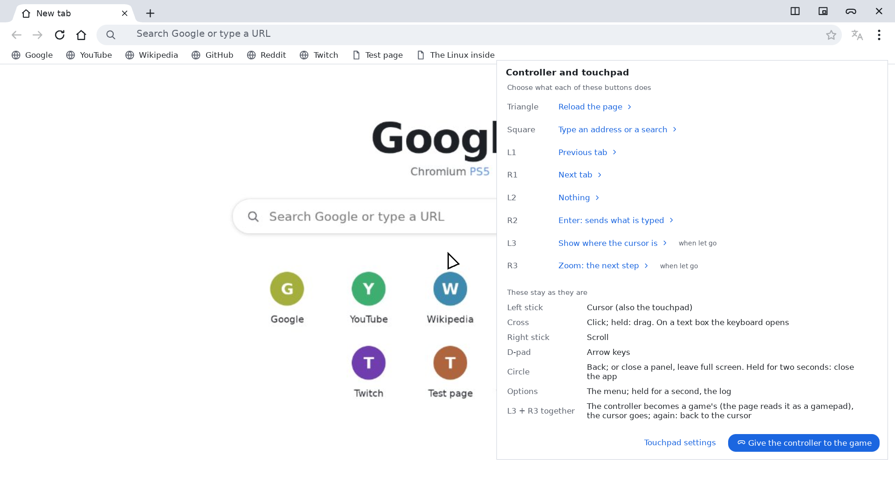
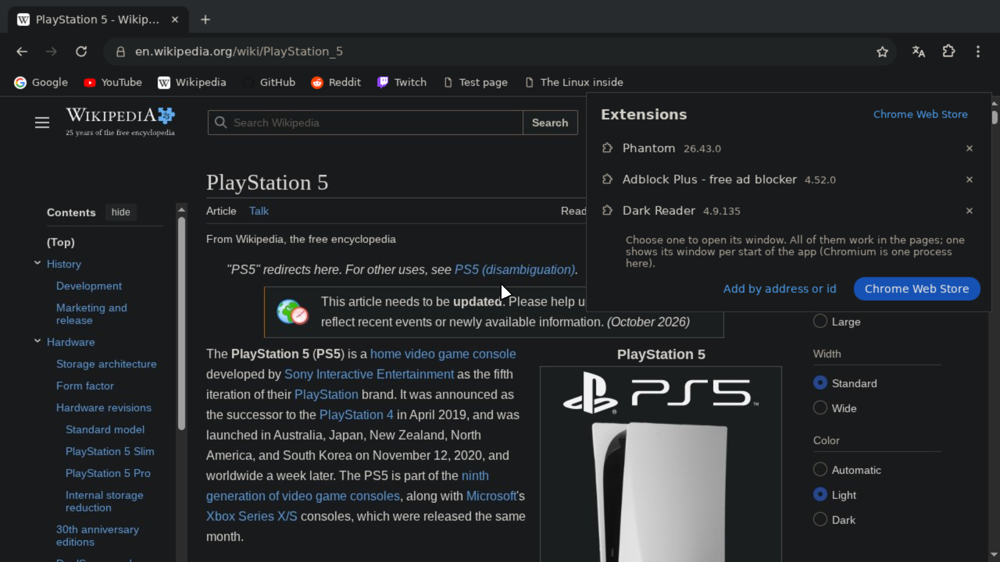
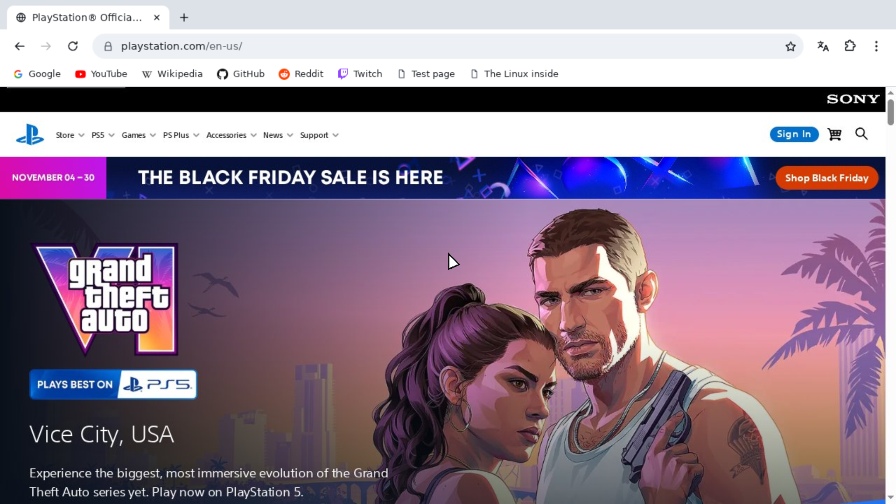
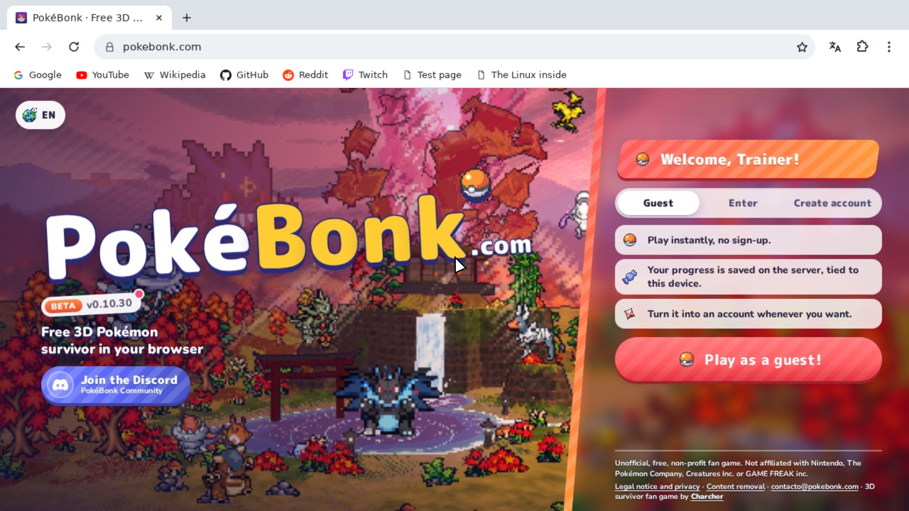
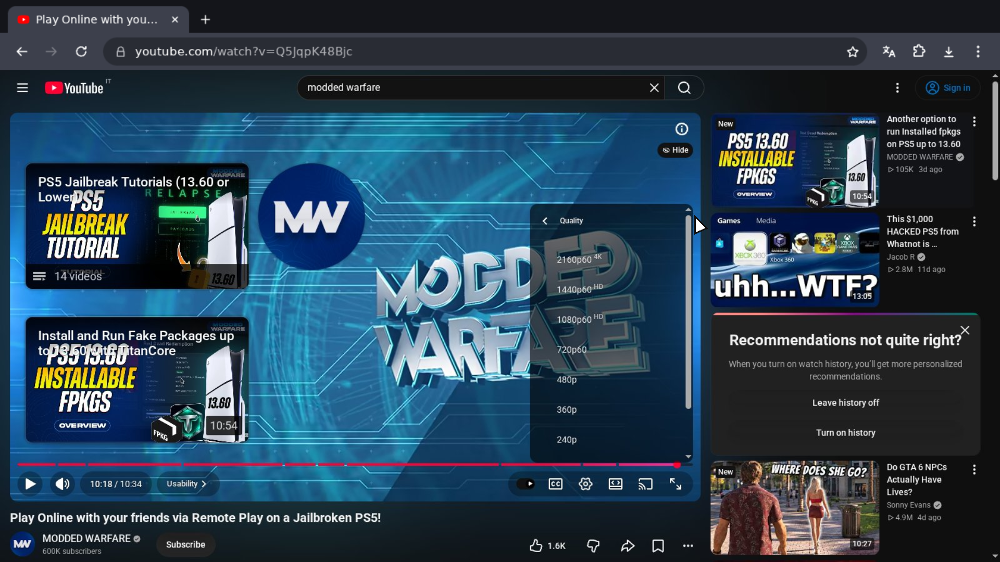

# Chromium PS5

Real Chromium running as a native homebrew app on a jailbroken PS5. And I mean the real thing: it's the x86-64 Linux build from Debian (version 156), not a WebKit wrapper and not a recompiled port.

How? Under the app there is Linux as a library (LKL) plus **gx**, a little "guest executor" that loads Linux programs and turns their syscalls into stuff the console understands. gx is based on [chromium-nx](https://github.com/shodowlo/chromium-nx) by shodowlo (huge thanks) and was ported to x86-64 for this.

Current version: **1.0** (title id CHRM00000). Tested on PS5 firmware 4.00 with kstuff and ShadowMount.

## EDIT: new update, what's new in 1.0

- **The console GPU is used directly now, with Vulkan.** WebGL and WebGPU are drawn by the PS5 GPU, not in software anymore. On my PS5 the WebGL Aquarium, three.js (WebGL and WebGPU), the WebGPU samples, Babylon.js, PlayCanvas, Sketchfab and krunker all run at 60 FPS. The Vulkan part comes from [PS5_Vulkan](https://github.com/mihawk-99/PS5_Vulkan) by Mihawk-99 (RADV running on the PS5), and a bit from [ps5-app-sdk](https://github.com/cybervisi0n/ps5-app-sdk) by cybervisi0n that I tested too.
- **Sign in with Google works.** Gmail, YouTube, and also the "Sign in with Google" button of other sites (tested on Reddit): the Google window opens, you log in and it brings you back to the site already logged in.
- **Upload files from the console.** When a site asks for a file (a forum, a profile picture, a document) a file window opens, like the Windows one: Downloads, Homebrew, the console storage and your USB drives on the left, the files on the right with size and date. Photos have thumbnails and a bigger preview, so you know wich one you are picking. It only shows the kind of files the site wants (you can still see all of them), and you can pick more than one if the site allows it. The file is read straight from the disk while it's uploaded, so big files work too.
- **Buttons on the top right**, like a PC window: split screen, floating window, controller and close the app.
- **Change what the controller buttons do.** In the controller panel (the button on the top right, or menu → More tools) you choose what Triangle, Square, L1, R1, L2, R2, L3 and R3 do: reload, address bar, tabs, Enter, zoom, back, forward, new tab, close tab, home, menu, full screen, downloads, history, bookmarks or nothing. The hints in the corner follow your choice. Cross, Circle, Options and the sticks stay the same so you can never lock yourself out.
- **Real keyboard and mouse**, USB or Bluetooth. The mouse moves the cursor (left click, right click for the menu, middle click opens the link in a new tab, side buttons back/forward, wheel scrolls). With a keyboard you type straight into the page, the system keyboard doesnt pop up anymore. Italian or US layout (it follows the console language), and the usual shortcuts: Ctrl+T, Ctrl+W, Ctrl+L, Ctrl+R / F5, Ctrl+Tab, Alt+left/right, Esc.
- **Sharper and smaller interface.** The bar on top, the menus and the panels (downloads, extensions, translate, settings...) are drawn at the full 1080p of the console now, so the text isnt blurry anymore, and they are smaller so the page gets more space.
- **New tab layout**: the tabs have slanted sides like desktop Chrome, the + is right next to the last tab, and there's a Home button next to reload (in Settings you can make it open any page you want, like google.com). The button hints show for 5 seconds and come back when you press Options.
- **Gamepad mode for web games**: press L3+R3 together (or "Give the controller to the game" in the controller panel) and the controller goes to the game as a real gamepad, press them again to get the cursor back.
- Games in full screen now really fill the screen (before some sites stayed stuck on their menu until you pressed Circle).
- Logins and cookies are saved the same way Chrome does it, so you stay logged in after closing the app.
- Less stutter: fixed a memory leak that froze heavy pages after a few minutes, and heavy WebAssembly games load faster.
- And a lot of small things and details here and there.

| | |
|---|---|
|  |  |
| Split screen, 2 tabs side by side | One tab as a floating window |
|  |  |
| Extensions from the Chrome Web Store (thats Dark Reader making the page dark) | A theme from the Chrome Web Store, on the new tab page |
|  |  |
| GitHub | playstation.com |
|  |  |
| pokebonk.com, a 3D WebGL game | YouTube on the PS5, a Modded Warfare video with quality up to 2160p60 |

The youtube screenshot is taken on a real PS5 (menu, "Take a screenshot"). The others are from the PC test bench, wich runs the exact same code as the console (the first one is 1.0, the others are still from 0.9.3).

## What it can do

- Pages are rendered by the real engine (Blink + V8), up to 60 FPS. The JIT is on and WebAssembly works. In Settings you find the javascript options **Fast** and **Safe**: if the app closes too early two times in a row it goes to Safe on its own, so you can't get stuck in a crash loop.
- WebGL 1 and 2 and WebGPU on the console GPU (Vulkan). If the GPU ever makes the app close at start, the next start goes back to software rendering on its own.
- Tabs, up to 12, with tab strip,back/forward/reload/home, an address bar that also searches (Google, DuckDuckGo, Bing or Brave), bookmarks, history and a new tab page. Open tabs come back at the next start. There's also "Reopen closed tab" and "Close tabs to the right" like on desktop Chrome.
- 2 tabs on screen at the same time: split screen (you can drag the bar in the middle) or one tab as a floating window that you move and resize. Hold a tab and drag it down on the page: left or right = split, middle = floating. It's in the menu aswell, and on the top right.
- **Translate**. It's the button right after the address bar. It translates the page in place, from any language (detected automatically or chosen by you) to any of 133 languages. What the page loads later gets translated too.Same for the next pages you open on that site. "Show original" brings everything back. By default it translates to the console language, you can change it in the panel or in Settings → Languages. Keep in mind the text of the page is sent to Google Translate.
- Extentions and themes from the Chrome Web Store. Just press "Add to Chrome" on the store page (or use "Add by address or id" in the extensions panel). A theme changes the colors of the whole interface.
- Sound! For videos and pages. You can turn it off from the menu, More tools.
- Google sign-in, and "Sign in with Google" on other sites. Cookies, logins and extensions are kept between restarts. They are stored on a data disk that the app creates the first time it starts (`/data/chromium-ps5/browser.img`).
- Uploading files to sites, from the console's disks and USB drives, with a file window that shows thumbnails and a preview of photos.
- A real keyboard and mouse (USB or Bluetooth), or the system keyboard for the address bar and for every text box inside pages.
- The touchpad of the controller is the mouse too: slide to move, tap to click, two fingers to scroll, two finger tap for the context menu, press and slide to drag.
- Controller buttons you can change, and gamepad mode for web games (L3+R3).
- Real full screen for videos (yes, youtube too) and games, it covers the tab strip too.
- Downloads are written directly to the console disk while they arrive, so a big file doesnt have to fit in memory. They go to `/data/download` or `/data/homebrew`. A `.ffpkg` always asks you where to put it. "Save page as PDF" saves in the same folder.
- Incognito: nothing goes in the history, cookies and site data are forgotten when you leave it (or if the app closes while you are in it).
- Ad block (Settings → Privacy): ads and trackers are not even contacted and YouTube plays without ads.
- Fonts: Liberation (same metrics of Arial, Times New Roman and Courier New), color emoji, Chinese, Japanese, Korean, Thai, the languages of India, Arabic, Hebrew and more.
- Screenshots from the menu, they end up in `/data/chromium-ps5/screenshots`.
- Then the usual things: find in page, zoom, light and dark theme (the dark one is passed to the sites too), site info, "Not secure" for plain http, "View page source", clearing cookies and cache from Settings → Privacy, and a context menu (open link in new tab, copy, search the selection, translate, video in fullscreen).
- A full log: on screen (hold Options), live over the network (`nc <ps5-ip> 9031`) and in `/data/chromium-ps5/logs/`, crash reports included.

## Install

1. Download `CHRM00000.ffpkg` from the [Releases](../../releases), copy it to `/data/homebrew/` and mount it with ShadowMount. (Or take the `CHRM00000` folder from the release zip and copy that to `/data/homebrew/`.)
2. Open Chromium PS5. To close it hold Circle for 2 seconds, or press the X on the top right.

Thats it, one file with everything inside, the Linux system too.

Updating: close the app first, then replace the `.ffpkg`. Dont open the app while you are copying the new one.

Coming from 0.8.6 or older? `/data/chromium-ps5/rootfs.img` is not used anymore and you can delete it. Dont touch `browser.img`, `profile`, `logs` and `screenshots` in that folder, those are in use.

## Controls

| | |
|---|---|
| Touchpad, one finger | slide = move, tap = click, double tap = select a word |
| Touchpad, two fingers | slide = scroll, tap = context menu |
| Touchpad pressed | click and drag (with two fingers: context menu) |
| Left stick / Cross | cursor / click (hold to drag, on a text box it opens the keyboard) |
| Right stick | scroll |
| D-pad | arrow keys |
| R2 | Enter |
| Square | type an address or a search |
| Triangle | reload |
| Circle | back, close a panel, exit full screen (hold 2 seconds: close the app) |
| L1 / R1 | previous / next tab |
| R3 | zoom |
| L3 | shows where the cursor is |
| L3 + R3 | gamepad mode for web games (again to go back to the cursor) |
| Options | menu and button hints (hold: shows the log screen) |

Triangle, Square, L1, R1, L2, R2, L3 and R3 are the defaults, you can change them in the controller panel (top right).

With a keyboard: Ctrl+T new tab, Ctrl+W close tab, Ctrl+L or F6 address bar, Ctrl+R or F5 reload, Ctrl+Tab next tab, Alt+left/right back/forward, Esc exit full screen.

## What's missing

- More than one process. Chromium runs as a single process here, thats why Incognito is a mode and not a window next to the normal tabs, and why only one extension per app start can show it's own window (they all work inside the pages anyway).
- Games that lock the mouse (first person shooters): the mouse moves the cursor but doesnt turn the camera yet.
- DRM (Widevine), so Netflix and the like dont play.
- Controllers that are not from PlayStation.
- The original Chrome interface. This one is a page made for the app with the same layout, drawn by Chromium itself.
- Translate doesn't touch what is inside frames and doesn't flip the page for right-to-left languages.
- System clipboard: copy and paste stay inside the browser.

## About the files in this repo

The `CHRM00000` folder is the app without 2 files: `rootfs.img` (the Linux system the app boots, 200 MB, too big for a single file on github) and `sce_module/libc.prx` (it's Sony's). Both are inside the release files, so install from a Release and you're fine.

Chromium is the Debian package as it is. There is only one fix applied to its binary when the image is built: three calls (seven bytes each) are removed, otherwise saving a PDF closes the browser when everything runs in one process.

## Credits and license

- shodowlo for [chromium-nx](https://github.com/shodowlo/chromium-nx), gx comes from there
- Mihawk-99 for [PS5_Vulkan](https://github.com/mihawk-99/PS5_Vulkan), the Vulkan driver (RADV) on the PS5
- cybervisi0n for [ps5-app-sdk](https://github.com/cybervisi0n/ps5-app-sdk)
- Sean Barrett for [stb](https://github.com/nothings/stb), the image code used for the thumbnails
- the LKL, Mesa, ps5-opengl, Chromium and Debian projects

GPL-2.0 (gx, LKL), GPL-3.0-or-later (app shell, ps5-opengl), MIT (Mesa/RADV), public domain (stb). Not affiliated with Google or Sony.
