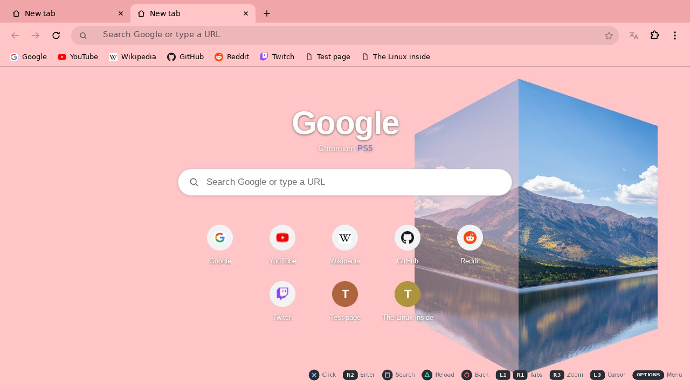
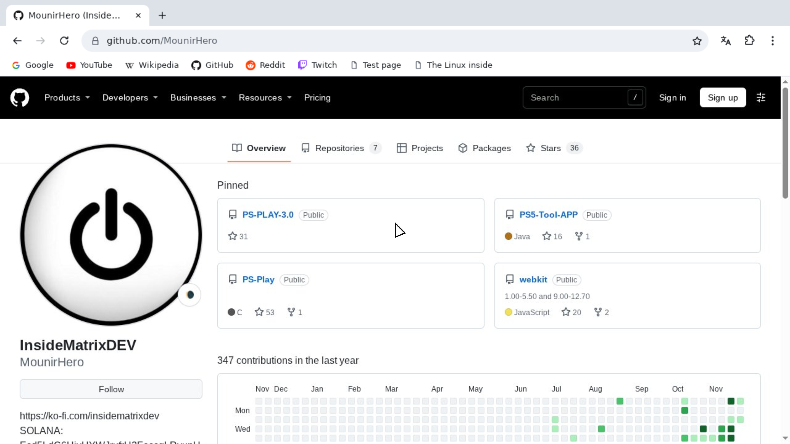

# Chromium PS5

Real Chromium running as a native homebrew app on a jailbroken PS5. And I mean the real thing: it's the x86-64 Linux build from Debian (version 156), not a WebKit wrapper and not a recompiled port.

How? Under the app there is Linux as a library (LKL) plus **gx**, a little "guest executor" that loads Linux programs and turns their syscalls into stuff the console understands. gx is based on [chromium-nx](https://github.com/shodowlo/chromium-nx) by shodowlo (huge thanks) and was ported to x86-64 for this.

Current version: **0.9.3 build 41** (title id CHRM00000). Tested on PS5 firmware 4.00 with kstuff and ShadowMount.

| | |
|---|---|
|  |  |
| Split screen, 2 tabs side by side | One tab as a floating window |
|  |  |
| Extensions from the Chrome Web Store (thats Dark Reader making the page dark) | A theme from the Chrome Web Store, on the new tab page |
|  |  |
| GitHub | playstation.com |
|  | |
| pokebonk.com, a 3D WebGL game | |

Screenshots are taken on the PC test bench, wich runs the exact same code as the console.

## What it can do

- Pages are rendered by the real engine (Blink + V8), up to 60 FPS. The JIT is on and WebAssembly works. In Settings you find the javascript options **Fast** and **Safe**: if the app closes too early two times in a row it goes to Safe on its own, so you can't get stuck in a crash loop.
- Tabs, up to 12, with tab strip,back/forward/reload, an address bar that also searches (Google, DuckDuckGo, Bing or Brave), bookmarks, history and a new tab page. Open tabs come back at the next start. There's also "Reopen closed tab" and "Close tabs to the right" like on desktop Chrome.
- 2 tabs on screen at the same time: split screen (you can drag the bar in the middle) or one tab as a floating window that you move and resize. Hold a tab and drag it down on the page: left or right = split, middle = floating. It's in the menu aswell.
- **Translate** (new in 0.9.3). It's the button right after the address bar. It translates the page in place, from any language (detected automatically or chosen by you) to any of 133 languages. What the page loads later gets translated too.Same for the next pages you open on that site. "Show original" brings everything back. By default it translates to the console language, you can change it in the panel or in Settings → Languages. Keep in mind the text of the page is sent to Google Translate.
- Extentions and themes from the Chrome Web Store. Just press "Add to Chrome" on the store page (or use "Add by address or id" in the extensions panel). A theme changes the colors of the whole interface.
- Sound! For videos and pages. You can turn it off from the menu, More tools.
- Cookies, logins and extensions are kept between restarts. They are stored on a data disk that the app creates the first time it starts (`/data/chromium-ps5/browser.img`).
- The system keyboard, for the address bar and for every text box inside pages.
- The touchpad of the controller is the mouse: slide to move, tap to click, two fingers to scroll, two finger tap for the context menu, press and slide to drag.
- Real full screen for videos (yes, youtube too), it covers the tab strip too.
- Downloads are written directly to the console disk while they arrive, so a big file doesnt have to fit in memory. They go to `/data/download` (the same folder Torrent & DL uses) or `/data/homebrew`. A `.ffpkg` always asks you where to put it. "Save page as PDF" saves in the same folder.
- Incognito: nothing goes in the history, cookies and site data are forgotten when you leave it.
- Ad block (Settings → Privacy): ads and trackers are not even contacted and YouTube plays without ads.
- WebGL 1 and 2. For now it's software rendering with SwiftShader, the GPU of the console is not used yet. 3D games run at half resolution by default to get more FPS (you can change it in Settings).
- Fonts: Liberation (same metrics of Arial, Times New Roman and Courier New), color emoji, Chinese, Japanese, Korean, Thai, the languages of India, Arabic, Hebrew and more.
- Screenshots from the menu, they end up in `/data/chromium-ps5/screenshots`.
- Then the usual things: find in page, zoom, light and dark theme (the dark one is passed to the sites too), site info, "Not secure" for plain http, "View page source", clearing cookies and cache from Settings → Privacy, and a context menu (open link in new tab, copy, search the selection, translate, video in fullscreen).
- A full log: on screen (hold Options), live over the network (`nc <ps5-ip> 9031`) and in `/data/chromium-ps5/logs/`, crash reports included.

Note: 0.9.3 is fresh. The last build that actually ran on a PS5 is 0.9.2 build 40, the Translate button was tested only on the PC test bench so far, and sound still has to be confirmed on a real console. If something is broken tell me.

## Install

1. Download `CHRM00000.ffpkg` from the [Releases](../../releases), copy it to `/data/homebrew/` and mount it with ShadowMount. (Or take the `CHRM00000` folder from the release zip and copy that to `/data/homebrew/`.)
2. Open Chromium PS5. To close it hold Circle for 2 seconds.

Thats it, one file with everything inside, the Linux system too.

Coming from 0.8.6 or older? `/data/chromium-ps5/rootfs.img` is not used anymore and you can delete it. Dont touch `browser.img`, `profile`, `logs` and `screenshots` in that folder, those are in use.

## Controls

| | |
|---|---|
| Touchpad, one finger | slide = move, tap = click, double tap = select a word |
| Touchpad, two fingers | slide = scroll, tap = context menu |
| Touchpad pressed | click and drag (with two fingers: context menu) |
| Left stick / Cross | cursor / click (hold to drag, on a text box it opens the keyboard) |
| Right stick | scroll |
| D-pad | arrow keys |
| R2 | Enter |
| Square | type an address or a search |
| Triangle | reload |
| Circle | back, close a panel, exit full screen (hold 2 seconds: close the app) |
| L1 / R1 | previous / next tab |
| L3 / R3 | show the cursor / zoom |
| Options | menu (hold: the log) |

## What's missing

- The console GPU. Everything (pages and WebGL) is drawn in software, so heavy 3D is slow.
- More than one process. Chromium runs as a single process here, thats why Incognito is a mode and not a window next to the normal tabs, and why only one extension per app start can show it's own window (they all work inside the pages anyway).
- The original Chrome interface. This one is a page made for the app with the same layout, drawn by Chromium itself.
- Translate doesn't touch what is inside frames and doesn't flip the page for right-to-left languages.
- System clipboard: copy and paste stay inside the browser.

## About the files in this repo

The `CHRM00000` folder is the app without 2 files: `rootfs.img` (the Linux system the app boots, 200 MB, too big for a single file on github) and `sce_module/libc.prx` (it's Sony's). Both are inside the release files, so install from a Release and you're fine.

Chromium is the Debian package as it is. There is only one fix applied to its binary when the image is built: three calls (seven bytes each) are removed, otherwise saving a PDF closes the browser when everything runs in one process.

## Credits and license

- shodowlo for [chromium-nx](https://github.com/shodowlo/chromium-nx), gx comes from there
- the LKL, ps5-opengl, Chromium and Debian projects

GPL-2.0 (gx, LKL), GPL-3.0-or-later (app shell, ps5-opengl). Not affiliated with Google or Sony.
